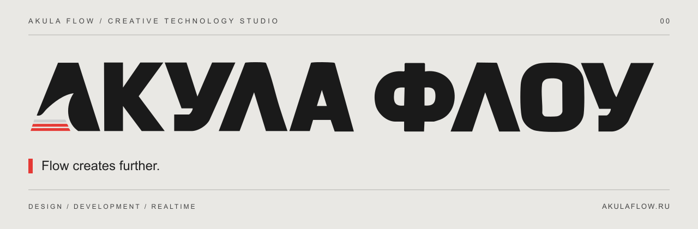

[Сайт](https://akulaflow.ru/) · [GitHub](https://github.com/yanakulov/akulaflow) · [GitVerse](https://gitverse.ru/yanakulov/akulaflow) · [Changelog](CHANGELOG.md)

# Акула Флоу

Текущая оболочка: **aNet 1.2.0**; AF packages: **0.2.0**.

**Дизайн, разработка и интерактивный веб.**

AkulaFlow соединяет визуальную идею, интерфейс и работающий продукт. От сайта и его управления до инструментов команды, публикаций и аналитики — в единой экосистеме.

## Что внутри

**Сайт AkulaFlow** — витрина студии, портфолио и интерактивные эксперименты.

**Akula Net (aNet)** — единая админка для сайта и подключаемых модулей. Основа — aCore; остальные возможности подключаются под задачи проекта.

| Продукт | Назначение | Репозитории |
|---|---|---|
| **aNet** | Единая админка и подключаемые модули | [GitHub](https://github.com/yanakulov/anet) · [GitVerse](https://gitverse.ru/yanakulov/anet) |
| **aCore** · Сердце Акулы | Страницы, пользователи, медиа и SEO — в одном интерфейсе. | [GitHub](https://github.com/yanakulov/acore) · [GitVerse](https://gitverse.ru/yanakulov/acore) |
| **aVision** · Глаза Акулы | Визуальное редактирование сайта через настоящие Vue-компоненты. | [GitHub](https://github.com/yanakulov/avision) · [GitVerse](https://gitverse.ru/yanakulov/avision) |
| **aFlow** · Поток Акулы | Проекты, доски, задачи и команда внутри aNet. | [GitHub](https://github.com/yanakulov/aflow) · [GitVerse](https://gitverse.ru/yanakulov/aflow) |
| **aJaws** · Пасть Акулы | Кросспостинг и расписание публикаций для Telegram и VK. | [GitHub](https://github.com/yanakulov/ajaws) · [GitVerse](https://gitverse.ru/yanakulov/ajaws) |
| **aSense** · Чутьё Акулы | Подробная аналитика, цели и поведение посетителей. | [GitHub](https://github.com/yanakulov/asense) · [GitVerse](https://gitverse.ru/yanakulov/asense) |

## Как части связаны

`aCore → aVision · aFlow · aJaws · aSense`

Общая авторизация, роли, контент и серверная проверка доступа. Клиентский starter получает базовую aCore; подключаемые модули активируются отдельно.

## Версии

Текущая документированная версия aNet — **1.0.0**. Совместимые пакеты AF Core / Vue / Nuxt / Editor / Licensing — **0.2.0**. История публичного каталога — в [CHANGELOG.md](CHANGELOG.md).

## О репозитории

Это публичный информационный репозиторий: описание продукта и журнал изменений. Исходники развиваются в приватных репозиториях. Публикация описания не предоставляет лицензию на программное обеспечение.

Сайт и связь со студией: [akulaflow.ru](https://akulaflow.ru/).
